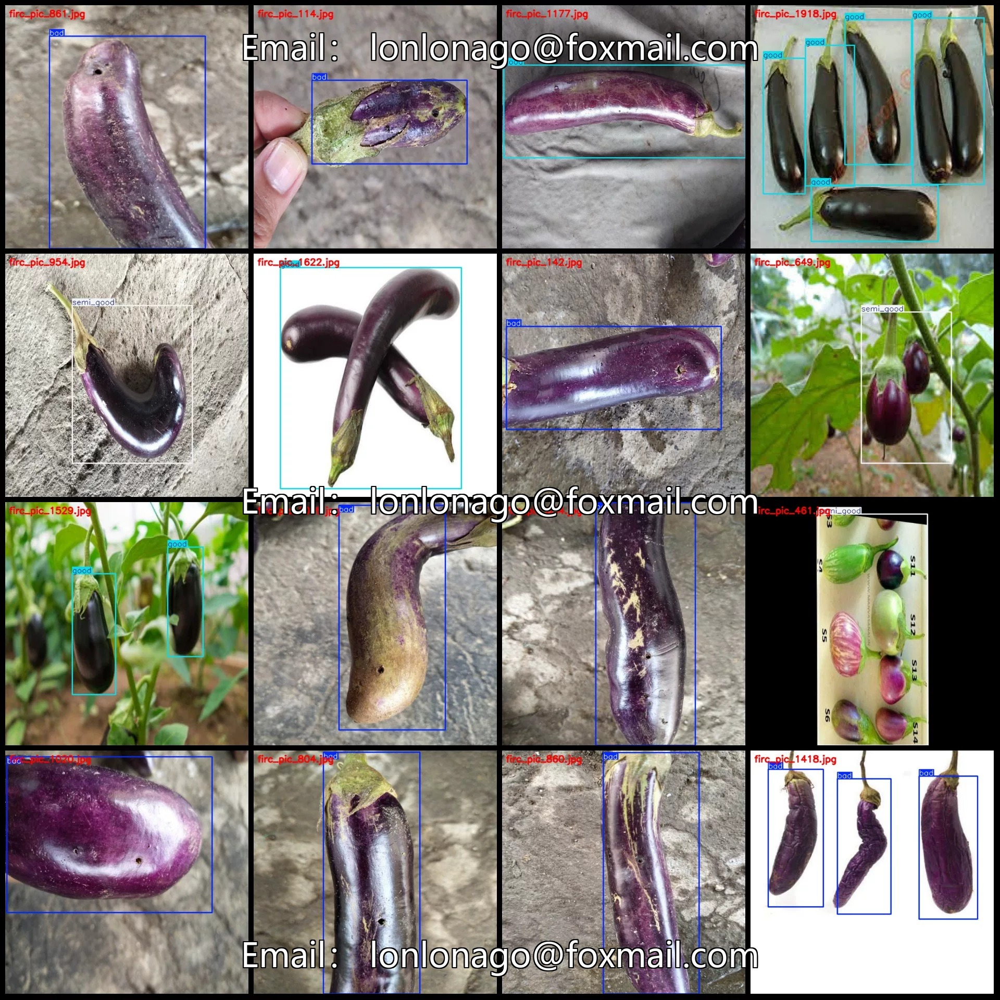
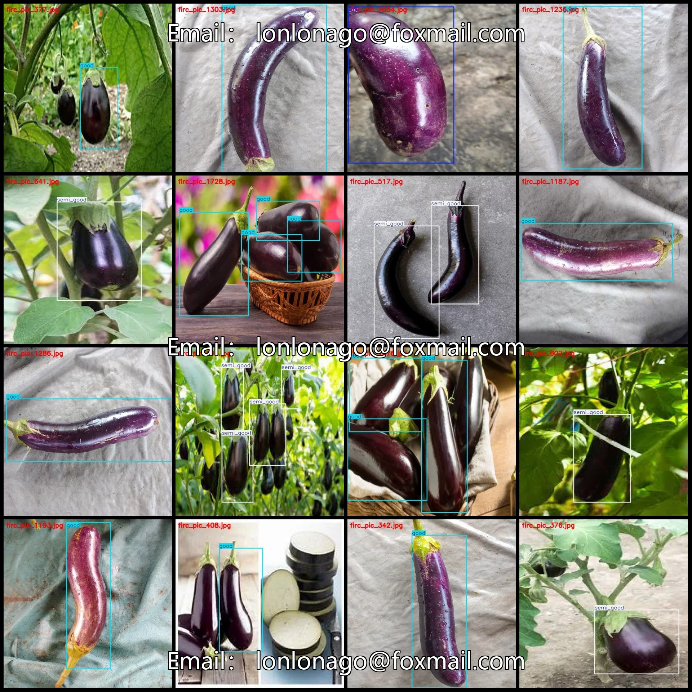
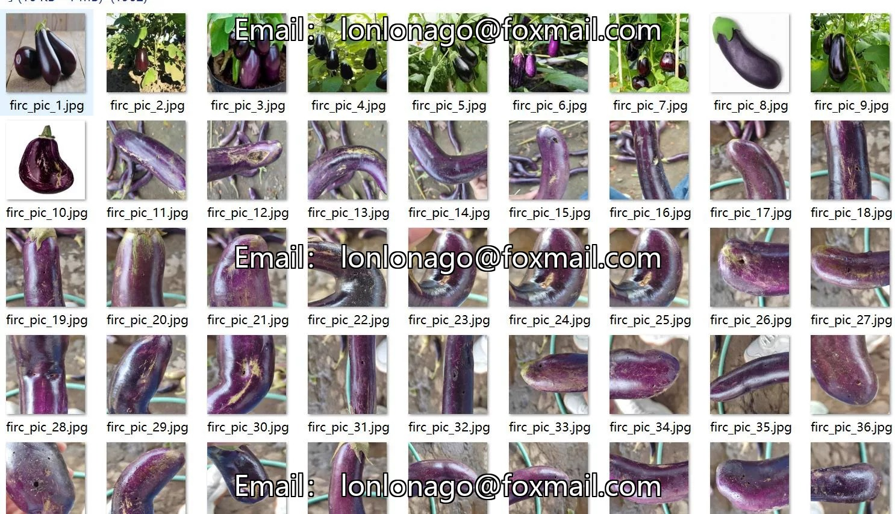
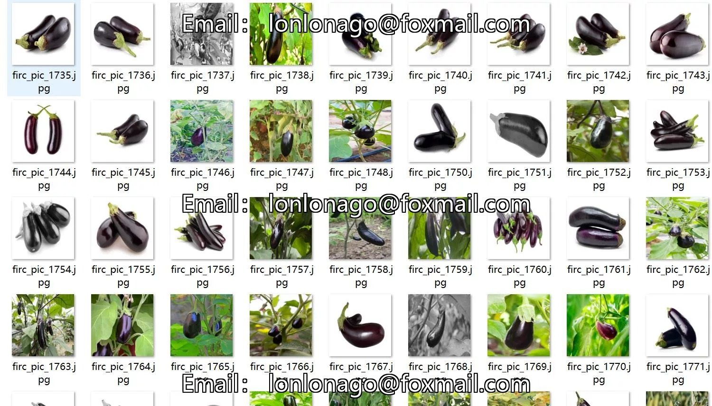
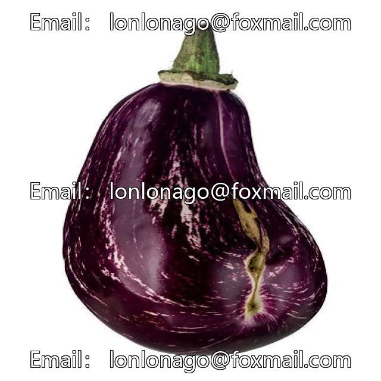
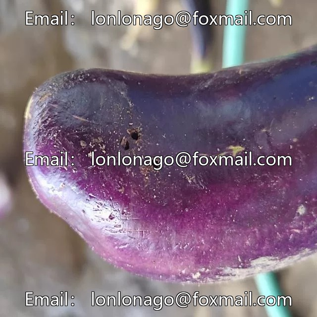

# Potato Quality Inspection Data Set in VOC+YOLO format, 1983 images, 3 categories

## Body

Potato Quality Inspection Data Set - VOC+YOLO format, 1983 images in 3 categories
Tips: Due to the dataset's replicability, please confirm compliance with requirements before purchasing.
Dataset format: Pascal VOC format + YOLO format (txt files without split paths, only containing jpg images and corresponding VOC format xml files and yolo format txt files)
Number of images (number of jpg files): 1983
Number of annotations (number of xml files): 1983
Number of annotations (number of txt files): 1983
Number of annotation categories: 3

Label categories (Note that the order of labels in YOLO format does not correspond to this, but is based on the classes.txt file in the labels folder): ["bad", "good", "semi_good"]
Number of bounding boxes and images per category:
- bad: 706 bounding boxes, 660 images
- good: 1403 bounding boxes, 940 images
- semi_good: 427 bounding boxes, 385 images
Total bounding boxes: 2536
Image resolution: 640x640
Labeling tool used: labelImg
Labeling rules: Draw a rectangle around the category
Important note: The dataset does not have separate training, validation, or test sets; you will need to manually divide them.

Special : This dataset does not guarantee the accuracy of the trained models or weight files.

## Images

## Payment

Here is a pay link on Stripe ( https://buy.stripe.com/3cs8yP7sY87d0vu9AB ). Please contact me lonlonago@foxmail.com after funding $89, and I will send you a complete data files , thank you!

